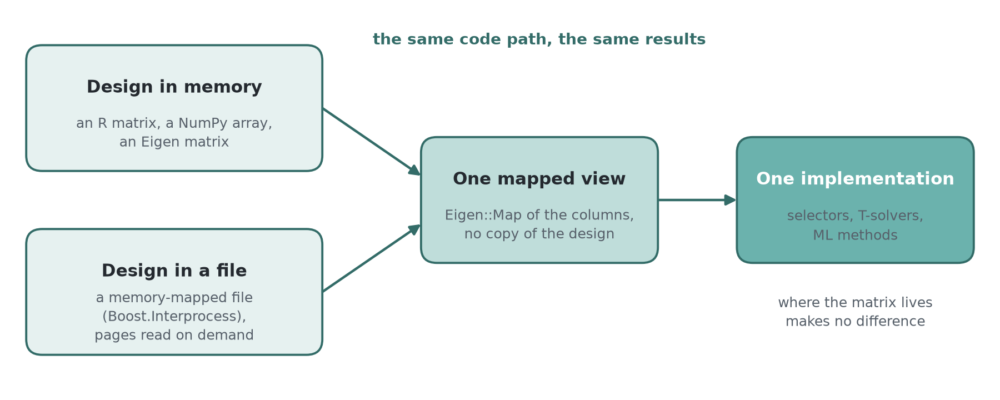

```{r setup, include = FALSE}
knitr::opts_chunk$set(collapse = TRUE, comment = "#>", fig.align = "center",
                      fig.width = 6, fig.height = 4, fig.retina = 2)
options(width = 80)
library(TRexSelector)
old_threads <- trex_set_num_threads(min(2L, trex_get_max_threads()))
```

# A design larger than the memory

A memory-mapped matrix lives in a file on disk, and the operating system pages the parts in use into
memory. The C++ backend binds such a file exactly as it binds an R matrix, so every selector, every
T-solver, the scalers, the low-memory regression engines and the clustering accept one. That is how a
sparse regression problem with five million variables was solved on a laptop [@scheidt2023bigtrex]. The
file holds the matrix as raw doubles in column-major order, the layout of R and Eigen, without a header.

The file is mapped through Boost.Interprocess [@gaztanaga2008interprocess], the library of the Boost
C++ Libraries for memory-mapped files and shared memory. In R, the bigmemory package
[@kane2013bigmemory] established disk-backed matrices for statistics, and the first Big T-Rex
[@scheidt2023bigtrex] was written for its `big.matrix` objects. The library binds any buffer instead,
mapped or not, so the selectors never see where the design lives, as Figure 1 shows.

```{r agnostic, echo = FALSE, out.width = "90%"}
#| fig.cap: "Figure 1: A design in memory and a design in a file reach the same implementation through one mapped view."

```

# Creating and opening a mapped matrix

`mem_matrix_from()` writes an R matrix to a file and returns a handle, `mem_matrix()` opens an existing
file with its dimensions and the access mode.

```{r create}
set.seed(5)
n <- 100
p <- 200
X <- matrix(rnorm(n * p), n, p)
path <- tempfile(fileext = ".bin")
mm <- mem_matrix_from(X, path)
class(mm)
dim(mm)
file.size(path) == 8 * n * p
```

The handle supports the matrix operations one needs to inspect and to edit the file. Reading a block
copies it into R memory, the backend never does.

```{r ops}
round(mm[1:2, 1:3], 3)
identical(mm[1:2, 1:3], X[1:2, 1:3])
mm[1, 1] <- 42
mm[1, 1]
mm[1, 1] <- X[1, 1]
max(abs(as.matrix(mm) - X))
ro <- mem_matrix(path, rows = n, cols = p, mode = "readonly")
tryCatch(ro[1, 1] <- 0, error = function(e) cat("error:", conditionMessage(e), "\n"))
```

# Streaming a design into the file

A design that does not fit in memory is written column by column. The file is raw doubles in
column-major order, so `writeBin()` of one column after another produces it.

```{r stream}
path2 <- tempfile(fileext = ".bin")
con <- file(path2, open = "wb")
for (j in seq_len(p)) {
  set.seed(1000 + j)
  writeBin(rnorm(n), con)
}
close(con)
big <- mem_matrix(path2, rows = n, cols = p, mode = "readwrite")
set.seed(1000 + 3)
max(abs(as.numeric(big[, 3]) - rnorm(n)))
```

# Selectors on a mapped design

The selectors take the handle where they take `X`. A selector centers and scales the design in place
and restores it when `select()` returns, so the file must be open in `"readwrite"` mode (the page on
working without data copies has the contract).

```{r select}
beta <- c(rep(1.5, 4), rep(0, p - 4))
y <- as.numeric(X %*% beta + rnorm(n))
sel_mem <- TRexSelector$new(X, y, tFDR = 0.1, seed = 3, verbose = FALSE,
                            control = trex_control(K = 10))
sel_mem$select()
sel_map <- TRexSelector$new(mm, y, tFDR = 0.1, seed = 3, verbose = FALSE,
                            control = trex_control(K = 10))
sel_map$select()
identical(sel_mem$selected_indices, sel_map$selected_indices)
max(abs(as.matrix(mm) - X))      # the file is restored up to rounding
```

The same holds for `TRexDASelector`, `TRexGVSSelector`, `TRexScreeningSelector`,
`TRexBiobankScreeningSelector`, `TRexSPCASelector` and `TRexTikhonovSelector`.
`trex_control(use_memory_mapping = TRUE)` additionally keeps the dummy matrices of the random
experiments in mapped files, for the case where $K \cdot L \cdot p$ dummy columns do not fit either.

One file serves one selector at a time. Do not run several selectors on the same file at the same
time under `"L2"` or `"ZSCORE"`, neither through a second handle in one session nor in several
processes. Each of them rewrites the file while it runs, so it would standardize data that another
one has already changed, and the selections come out wrong. The same holds for T-solvers with
`normalize = TRUE` or `intercept = TRUE`. The next section shows how several processes use one
design at once.

## A read-only file

The default mode `"readwrite"` serves every use and is the one the examples of this guide work
with. A file opened in `"readonly"` mode serves where nothing is written into it. For the selectors
that is `scaling_mode = "NONE"`, under which a selector takes the design as supplied. The file then holds the
design the selector works on, centered and scaled beforehand, and `trex_normalize_design()` applies
exactly the preprocessing of the selector. Under `"L2"` and `"ZSCORE"` a read-only file is refused
with an error that names this way out. Several processes can share one read-only file, because none
of them writes into it.

```{r readonly}
pre <- trex_normalize_design(X, y)
path_pre <- tempfile(fileext = ".bin")
invisible(mem_matrix_from(pre$X, path_pre))
pre_ro <- mem_matrix(path_pre, rows = n, cols = p, mode = "readonly")
sel_ro <- TRexSelector$new(pre_ro, pre$y, tFDR = 0.1, seed = 3, verbose = FALSE,
                           control = trex_control(K = 10, scaling_mode = "NONE"))
sel_ro$select()
identical(sel_ro$selected_indices, sel_mem$selected_indices)
tryCatch(TRexSelector$new(pre_ro, pre$y, verbose = FALSE),
         error = function(e) cat(strwrap(paste("error:", conditionMessage(e)), 90), sep = "\n"))
```

`TRexSPCASelector` centers the design in every run, so it needs `"readwrite"` mode under every scaling
mode.

# T-solvers and ML methods

A T-solver binds a memory-mapped `X` and a memory-mapped `D` as it binds a matrix in memory, the
scalers transform the file in place, the low-memory engines of the regressions read it in place, and
the clustering accepts it as `data`. The access mode follows the same rule as for the selectors. A T-solver with
`normalize = TRUE` or `intercept = TRUE` and the scalers write into the file and need `"readwrite"`
mode, while a T-solver with both options off and the fits of the regressions only read it and take a
`"readonly"` file, for `X` and for `D`.

```{r solver}
D <- matrix(rnorm(n * p), n, p)
s <- TLARS_Solver$new(mm, D, y)
s$execute_step(T_stop = 2)
s$get_active_predictor_indices()
s$restore()
z <- MLZScoreScaler$new()
invisible(z$fit_transform_inplace(mm))
round(mean(mm[, 1]), 12)
invisible(z$inverse_transform_inplace(mm))
en <- MLElasticNet$new(low_memory = TRUE)
en$fit(mm, y, alpha = 1, n_lambda = 20)
dim(en$get_coef())
```

# When it pays

A mapped design pays when the design does not fit into memory, when several solvers share one design
and the working set should be loaded once, and when a design is produced by a streaming process and read
afterwards. For a design that fits comfortably in memory an R matrix is faster, since no paging happens.
Mapped files are never read into R's heap by the backend, so the memory footprint of a run is the
backend's working data, see `get_memory_bytes()` on the T-solvers.

```{r cleanup, include = FALSE}
rm(mm, ro, big, s, pre_ro, sel_ro)
invisible(gc())
unlink(c(path, path2, path_pre))
trex_set_num_threads(old_threads)
```

# Examples

The [TRexSelector_Examples](https://github.com/trexselector/TRexSelector_Examples/tree/main)
repository holds runnable demos and Monte Carlo studies of memory-mapped designs, with their results
and a README per demo, in
[R](https://github.com/trexselector/TRexSelector_Examples/tree/main/R/memory_mapping/demo_memory_mapping),
[Python](https://github.com/trexselector/TRexSelector_Examples/tree/main/Python/memory_mapping/demo_memory_mapping)
and
[C++](https://github.com/trexselector/TRexSelector_Examples/tree/main/cpp/memory_mapping/demo_memory_mapping).

# Bibliography
